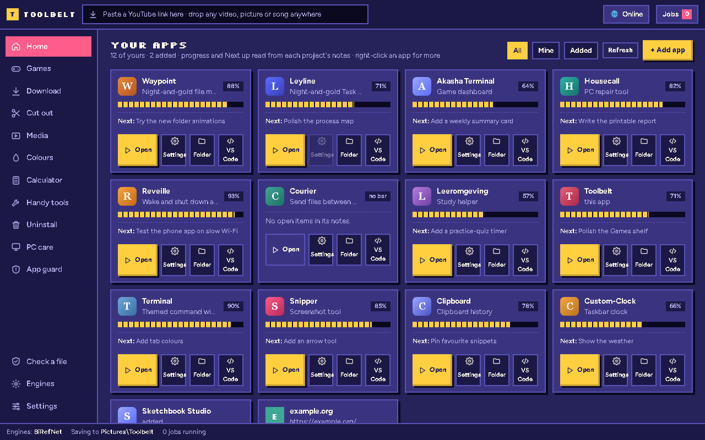
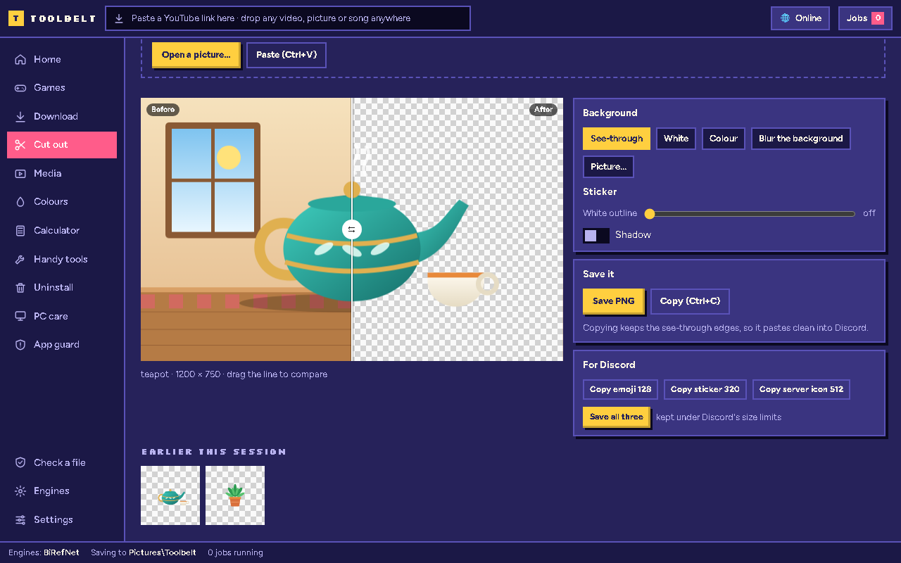
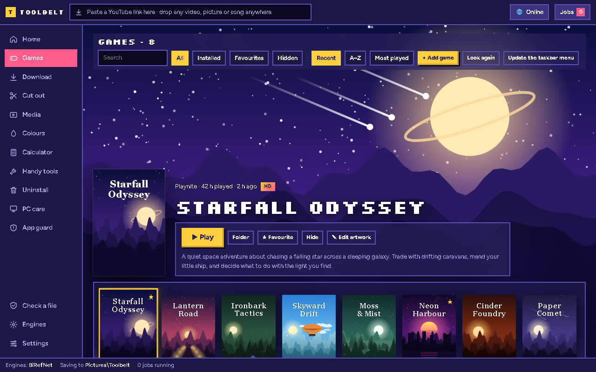

# Toolbelt

**One Windows app for the everyday things you'd otherwise use a dozen websites and tools for.** Built with Python and a
web page in a [pywebview](https://pywebview.flowrl.com/) window: no web server, no open network ports, and the
pictures, videos and songs you work on never leave your PC.

Three looks (Cartridge, Glass, Glass Dark), its own window bar, a tray icon and a taskbar menu for your games.

<p align="center">
  
  
  
</p>

<sub>The screenshots use demo projects and made-up games.</sub>

## What's in it

| Screen | What it does |
|---|---|
| **Home** | Your own projects (found from their `status.md` notes, with progress) plus any app or website you add. Edit mode to hide or remove cards. |
| **Games** | Your library from Steam and Playnite, with full-screen art (SteamGridDB, optional), a slideshow and Wallpaper Engine backgrounds. |
| **Download** | Videos up to 4K, video without sound, or just the sound (yt-dlp). Songs go to a folder Spotify reads, with a cover editor, tags that lyrics add-ons can find, and lyrics files (`.lrc`, and `.ttml` for Spicy Lyrics). |
| **Cut out** | Removes the background from a picture on your own graphics card (BiRefNet through DirectML). |
| **Media** | Convert, compress for Discord, GIF / WebM from a clip, crop, many pictures at once (HEIC too), cut and even out sound, AI upscaling (Real-ESRGAN), a video player with before / after. |
| **Colours** | Colour picker, palettes, gradients and their code in many formats. |
| **Calculator** | A Casio-style scientific calculator where you type straight into stacked fractions, roots and powers; fractions with steps, equations, tables, graphs, programmer mode, units and dates. A floating mini version. |
| **Handy tools** | QR codes (also Wi-Fi), a colour picker for the whole screen, renaming many files with undo, checksums. |
| **Uninstall** | An uninstaller with a restore point first and a leftover scan afterwards; startup apps. |
| **PC care** | Drivers (and what Windows Update offers), ping and lag to your router, the internet and game servers. |
| **App guard** | Notices programs starting for the first time, checks them (signature, disguised names, Defender, where it was downloaded) and lets you trust, allow once or stop and quarantine them. Program check, Defender scans, USB stick and Downloads checks. |
| **Internet switch** | One button in the top bar that switches the network adapter off and on, like pulling the cable. |

## Getting it running

Windows 10 or 11. Paste this into PowerShell:

```powershell
irm shamilimanuel.github.io/toolbelt | iex
```

(The long form, straight from this repo: `irm https://raw.githubusercontent.com/Shamilimanuel/Toolbelt/main/install.ps1 | iex`.)

Or download **[ToolbeltSetup.exe](https://github.com/Shamilimanuel/Toolbelt/releases/latest/download/ToolbeltSetup.exe)**
(11 KB) and run it. It isn't signed (a code-signing certificate costs money every year), so Windows may say
"Windows protected your PC": **More info → Run anyway**. Its source is [`setup-exe/ToolbeltSetup.cs`](setup-exe/ToolbeltSetup.cs).

Or download the code (**Code → Download ZIP**), unzip it and double-click **`Install.cmd`**. All three do the same:
the one-liner and the .exe download the code for you ([`install.ps1`](install.ps1), short and readable).

It installs for your Windows user only, without admin rights:
1. finds Python 3.12 or newer, and offers to install it with winget if there's none;
2. copies the app to `%LOCALAPPDATA%\Programs\Toolbelt` (the unzipped folder can go afterwards);
3. makes Toolbelt's own Python folder in `%LOCALAPPDATA%\Toolbelt\venv` and installs the packages (a few minutes);
4. adds Toolbelt to **Settings → Apps**, and starts it. On its first start it adds itself to the Start menu.

**Updating:** run the same line (or a newer `Install.cmd`) again; your settings and engines stay.
**Uninstalling:** Settings → Apps → Toolbelt → Uninstall. It puts back what Toolbelt changed in Windows (the
Calculator key, Win+W, the internet switch, the Start-menu entries) and asks before removing your data.

`Install.cmd` only runs `setup.ps1`, a plain script you can read first. By hand it's:

```bat
py -m venv "%LOCALAPPDATA%\Toolbelt\venv"
"%LOCALAPPDATA%\Toolbelt\venv\Scripts\pip" install -r requirements.txt
"%LOCALAPPDATA%\Toolbelt\venv\Scripts\pythonw" main.py
```

The heavier tools are installed from inside the app, only when you press Install on the **Engines** screen, into
`%LOCALAPPDATA%\Toolbelt\engines`:

| Engine | For | Licence |
|---|---|---|
| yt-dlp (+ Deno) | downloading | Unlicense (Deno: MIT) |
| ffmpeg | converting, joining, compressing | GPL |
| BiRefNet | cut-outs | MIT |
| Real-ESRGAN | upscaling | BSD |

## Where things are kept

Settings, engines, caches and App guard's records live in `%LOCALAPPDATA%\Toolbelt`, never in the program folder.
Nothing you process is uploaded anywhere. Toolbelt only goes online when you ask it to: a download, an engine install,
a lyrics or artwork lookup, Windows Update's driver list.

Home shows projects that sit next to the Toolbelt folder and keep a `status.md` (or `TASK.md`). How each one starts can
be set on the page (right-click a card), or in `%LOCALAPPDATA%\Toolbelt\launch.json`.

## Tests

```bat
python tests\run_all.py -v
```

The page tests run in an invisible Chrome through [Playwright](https://playwright.dev/python/); the rest use made-up
files in temporary folders. Nothing opens a window on your screen.

## Privacy

- **Your files stay on your PC.** Pictures, videos and songs are processed locally and never uploaded.
- **No account, no tracking.** Toolbelt only goes online when you ask it to (see "Where things are kept" above).
- **No server and no open ports:** the window is a local page handed to pywebview as text.
- **Installs for your Windows user only**, without admin rights, and puts back what it changed when you uninstall.

## Licence

[MIT](LICENSE). The engines keep their own licences (see the table above).

More projects: https://github.com/Shamilimanuel
